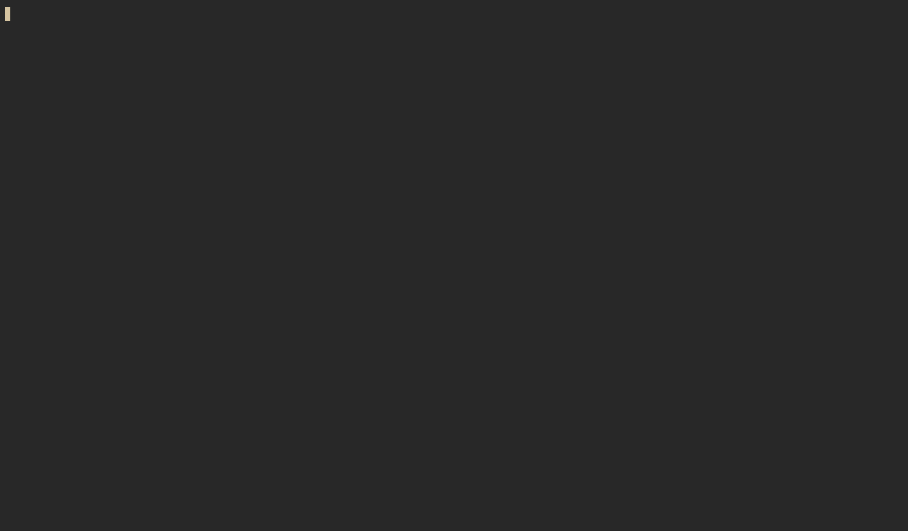

# fibrous.nvim

A declarative, component-based, React-like UI framework for Neovim plugins. It
brings a VDOM, hooks, and subtree reconciliation to Neovim UI development, and
renders component trees inline: text + extmarks in one unmodifiable buffer, with
a CSS-like box model, cursor-driven hover/activation, and real editable floats
only where a native buffer is needed (text inputs, raw buffers).

## Docs and live demo

As a showcase of what this library can do, the documentation site is created in
fibrous itself, and runs in your browser using a WASM-compiled version of
Neovim! Access it [here](https://mbrea-c.github.io/fibrous-docs/). There are
interactive, hot-reloadable examples to play around with.



## Examples

Runnable sample UIs live in [`examples/`](examples/). They open in a clean,
isolated Neovim (no user config or other plugins):

```sh
make example              # opens Neovim; then :Examples / :Example <name>
make example EX=counter   # opens and runs one example directly
```

See [`examples/README.md`](examples/README.md) for the full list.

## Jump to widgets with flash.nvim

`require("fibrous.targets").targets(opts?)` returns every interactive element
currently on screen across **all** live mounts and their windows/floats as pure
geometry, shaped like a [flash.nvim](https://github.com/folke/flash.nvim) match.

This is optional and you don't need `flash.nvim` to use this library. If an user
wants to take advantage of this for easier navigation, they can set a global
keybind in their own config:

```lua
-- bind this to a <C-...> key, NOT a <Space>-leader chord: fibrous maps
-- <Space>/<CR>/<Tab>/i/a/d/c/v… buffer-locally, so a <Space> leader is
-- swallowed inside a fibrous window.
vim.keymap.set({ "n", "v" }, "<C-f>", function()
  require("flash").jump({
    -- wrap=true labels matches before the cursor too (else forward-only in
    -- the current window); let flash's default labeler assign the labels.
    search = { multi_window = true, wrap = true, incremental = false, max_length = 0 },
    matcher = function(win)
      local Pos = require("flash.search.pos")
      local out = {}
      for _, t in ipairs(require("fibrous.targets").targets({ winid = win })) do
        out[#out + 1] = { win = win, pos = Pos(t.pos), end_pos = Pos(t.end_pos) }
      end
      return out
    end,
  })
end)
```

`flash` jumps the cursor to the chosen widget. `opts` allows optional filters by
`winid`, `kinds` (e.g. `{ "button", "checkbox" }`), and an arbitrary
`predicate`. See the [API reference](https://mbrea-c.github.io/fibrous-docs/)
for the full shape.

The registry spans every mount, so any fibrous UI (this one, third-party
plugins, anything) becomes flash-navigable for free, with no cooperation from
the app.

## Inline overflow

Set `overflow = "hidden"` on an inline `ui.col` or `ui.row` to clip its
descendants to the allocated content box, including hover, activation, Tab
navigation, and jump targets. No extra buffer or window is created.

In a fixed-height mount, put a `grow = 1, overflow = "hidden"` content column
above a fixed-height footer button to keep the footer accessible. Use a popup
to view the full content, or `ui.container` for independent scrolling.

## Optional rendering optimizations

Weave-style long histories can opt into viewport rendering with
`fibrous.inline.visibility`. The owner builds only the requested entry range;
offscreen entries reserve blank native buffer rows. Normal `/` search and
multi-page yanks cannot read unmounted text. This is separate from native
Markdown reflow.

The Rust Markdown renderer is experimental and **off by default**. It retains a
single scroll-mode Markdown document between width changes. Parsing, component
execution, highlighting and edits remain in Lua. It supports paragraphs, lists,
quotes, tables, math, links and source mapping. Missing/incompatible native
modules, fixed-height or content-fitted UIs, whole-entry comment anchors,
general UI trees and unsupported styling use the normal Lua renderer. It does not accelerate Markdown nested inside an
arbitrary UI or Weave's virtualized transcript.

With the module installed, enable it before mounting:

```lua
require("fibrous").setup({ native_markdown = true })
-- Any mount can opt out with opts.native_markdown = false.
```

The Nix variant below both installs the module and enables this default.
`setup({ native_markdown = false })` disables it again. A source install remains
portable pure Lua, including the browser/Wasm documentation site.

## Nix

The flake packages the plugin and wraps the dev entry points (no local `nvim`
needed):

```sh
nix run .                                     # examples browser (same as .#example)
nix run .#example -- counter                  # open one example directly
nix run .#test                                # the full test suite
nix run .#test -- tests/inline/host_spec.lua  # one spec file
nix run .#bench                               # inline host benchmarks (BENCH_N=… env)
nix flake check                               # suite as a sandboxed check
```

Apps run against the flake's snapshot of the source (i.e. what's committed or
staged). Use the `make` targets against the working tree during development.

The plugin itself is also exposed as a flake output: `packages.<system>.default`
(built with `vimUtils.buildVimPlugin`). No Rust toolchain or module is built for
this default package.

Opt in through a package argument, or select its named equivalent:

```nix
fibrous.packages.${system}.default.override { withRustMarkdown = true; }
# Equivalent: fibrous.packages.${system}.fibrous-rust-markdown
```

The flake builds the LuaJIT module with a locked Cargo dependency set and places
it inside the plugin. No manual shared-library path or environment variable is
needed. Linux x86-64 is tested; other declared systems still need native runtime
verification.

```sh
nix run .#test-native
nix run .#bench-native-markdown -- --rounds 8 --out /tmp/fibrous-native
nix run .#bench-native-markdown-term -- --rounds 3 --out /tmp/fibrous-native
nix run .#bench-native-markdown-features -- --out /tmp/fibrous-native
```

The benchmarks compare against a benchmark-only optimized Lua wrapper, verify
rendering fingerprints, and include real PTY traffic. Native setup costs extra;
short documents and frequently edited text may not benefit. See
[the benchmark guide](bench/native_markdown/README.md).
